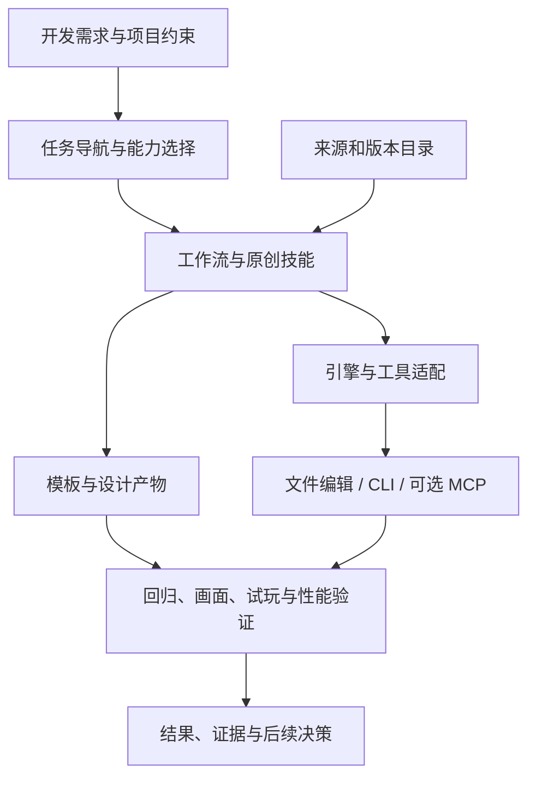

# GameDev Workbench：游戏开发技能、工具与知识库设计草案

日期：2026-11-10。状态：2026-11-10 已获用户同意执行。本文件保留设计阶段原文，实施进展以 README 和 docs/VALIDATION.md 为准。

## 1. 项目定位与已确认需求

为个人与小团队提供一个可安装、可阅读、可验证的游戏开发工作台。开发者提出真实任务，工作台结合项目约束，选择方法、知识与工具，交付设计或实现产物，并说明怎样验证。

用户已明确的首要需求是：整体代码工程架构设计、游戏 UI 的制作与绘制、各种效果和功能的实现。创意、机制、剧情、类型、受众等也需要全面覆盖。项目面向独立或较小规模游戏开发，必须能够用于 Godot 以外的引擎，并同时具备技能工具与游戏开发导引知识库的作用。

以下是本草案的设计选择，尚不是用户逐项确认的决定：

- 暂名 GameDev Workbench；以独立开源仓库交付，不放进现有游戏的运行时。
- 引擎中立的方法层，加 Godot、Unity、Unreal、轻量/Web 引擎适配资料；首个本地实证对象为当前 Godot 项目。
- 使用开放的 Agent Skills 格式，先形成可读工作流与可选能力包，再提供轻量本地检索工具。
- 中文优先；机器标识与目录使用英文。英文入口摘要随首发提供，全文翻译可后续补充。
- 自有代码、原创技能与模板暂定 Apache-2.0；第三方内容按各自许可处理。

成功的标准是：它能帮助使用者完成一次实际架构决策、一项可运行功能、一张可操作的游戏界面或一个可检查的视觉效果，而不只是给出更多网址。

## 2. 现成方案与项目的必要性

现成基础已经很多，详见配套资源调研表。多引擎技能库、Godot 专用能力包、引擎官方文档，以及编辑器 MCP 都值得优先采用。新项目应复用这些基础，把投入放在当前需求最缺的连接处：

1. 从一句需求走到项目约束、方案取舍、实现和验收。
2. 把工程架构、原生 UI、视觉效果和玩法目标放在同一条生产链里。
3. 明确区分公开参考、可安装工具、已复现能力与本项目验证。
4. 同一项任务能选择不同引擎后端，且尊重各项目现有架构。
5. 保留来源、版本、许可、失败经验和实际产物，支持持续更新。

存在几种合理形态：

| 形态 | 能解决的问题 | 局限 | 采用方式 |
|---|---|---|---|
| 精选资源目录 | 发现资料、工具和学习路径 | 用户仍要自己组织任务 | 作为知识基础 |
| 技能与工作流工具包 | 将需求变为可审查产物，能接现有编辑器与代理 | 需要逐项验证 | 推荐作为主体 |
| 完整平台与执行型 MCP | 统一检索、账号和编辑器操作 | 维护、权限、跨版本成本高 | 暂不作为首版主体 |

## 3. 能力地图：全面覆盖，按优先级做深

| 工作域 | 典型问题 | 应交付的产物 | 深度优先级 |
|---|---|---|---|
| 工程架构 | 模块怎么划分、状态归谁、怎样减少下一次改动成本 | 现状图、依赖与状态所有权、方案比较、契约、迁移计划 | 首要 |
| 功能实现 | 如何把需求接入现有代码、场景、数据与生命周期 | 规格、最小实现、回归证据、使用说明 | 首要 |
| 原生游戏 UI | HUD、菜单、设置、背包和三维空间 UI 怎么做 | 流程、状态表、布局、主题、输入导航、引擎内画面和操作证据 | 首要 |
| Shader / VFX / 动效 | 怎样做出有辨识度且不遮挡玩法的效果 | 分层拆解、参数与性能预算、实现、静态与动态对照 | 首要 |
| 游戏定位与受众 | 为什么做、给谁玩、承诺什么体验 | 体验支柱、类型假设、同类游戏证据、差异与规模边界 | 全面覆盖 |
| 创意与机制 | 创意如何变成值得验证的玩法 | 机制组合、核心循环、危险假设、小原型和试玩问题 | 全面覆盖 |
| 叙事与世界观 | 剧情怎样连接游戏状态和玩家选择 | 人物目标、因果链、分支、变量、演出与恢复规则 | 全面覆盖 |
| 关卡与内容 | 怎样安排空间、难度与节奏 | 灰盒、遭遇节奏、内容资源、可重复试玩路线 | 全面覆盖 |
| 美术方向与建模 | 风格怎样统一、模型怎样进入引擎 | 风格规则、轮廓/色彩/材质约束、资产规格、导入检查 | 全面覆盖 |
| 音频 | 音乐和音效怎样反馈玩法与情绪 | 事件表、层次、混音/循环规则、来源与致谢 | 全面覆盖 |
| 数值与经济 | 资源循环、难度和成长是否成立 | 模型、参数来源、敏感性、模拟与玩家验证 | 全面覆盖 |
| 测试、调试与性能 | 哪里错、哪里慢、改好了吗 | 复现、测量、行为回归、CPU/GPU 或画面证据 | 贯穿全部 |
| 无障碍、本地化与输入 | 不同设备与玩家能否顺利操作 | 导航与重绑检查、语言扩展、字幕和视觉可读性记录 | 贯穿全部 |
| 制作与发行 | 个人团队怎样控制规模并完成发布 | 垂直切片、里程碑、删减依据、商店表达和发布检查 | 全面覆盖 |

这里的“覆盖”表示有能实际执行的指导流程与资料入口；自动化程度、引擎支持和验证状态另外标注，不能用一张覆盖表声称所有自动化都已实现。

## 4. 使用方式与层次



### 人可以直接使用

打开“我现在要解决什么”导引，选择架构、UI、效果等工作流。每条流程附输入、步骤、产物、案例、验证方法和必要资料。没有代理或 MCP 也能阅读并执行。

### AI 代理可以按任务使用

入口技能读取项目约束与任务，选择最小的技能组合；只有被选中的技能和资料进入上下文。技能以通用步骤为主体，以适配说明补充具体引擎操作。支持格式与运行客户端的能力必须分开声明。

### 工具可以逐步接入

CLI、编辑器 API 和 MCP 是可替换的操作接口。没有 MCP 时，工作流仍能通过已有文件编辑、引擎命令和人工操作完成相应部分。若缺少实际必需能力，报告缺口；不得虚构已编译、已截图或已连接。

## 5. 三条优先生产链

### A. 整体架构设计与调整

输入：项目目标、引擎版本、代码/场景导航、仓库约束、当前问题和预计变化。

过程：读取约束 → 建立真实现状 → 找出变化压力 → 列出模块职责、状态所有者、依赖、生命周期和数据声明面 → 比较最小改动与更大调整 → 形成决策 → 设计分步迁移和验证。

输出至少包含：

- 实际代码与场景支持的现状图，区分运行时控制关系与目录结构。
- 状态读写所有权、事件/命令流、装配与销毁责任。
- 方案取舍：实现成本、可测试性、性能、后续变化成本。
- 接口契约、迁移边界、回退点和相关回归。

避免按模板强行引入 ECS、全局事件总线、依赖注入框架或大范围重构。只有任务证据支持时才采用。

### B. 游戏 UI 制作与绘制

输入：页面任务、信息优先级、玩家状态、输入设备、目标分辨率、视觉方向和当前实现。

过程：交互流程 → 状态表 → 布局草图 → 可复用主题 → 原生控件/自绘/三维界面的选择 → 引擎实现 → 多尺寸、键盘/手柄、暂停和模态层验证。

输出：界面结构、颜色/字体/间距声明面、真实数据绑定、输入焦点与返回规则、动效时序、可操作界面，以及引擎内截图或录屏。

Figma 可用来协作与评审；设计稿到 Godot Control、Unity UI Toolkit/uGUI、Unreal UMG/Slate 或 Web UI 的实现需要各自适配。不会把设计稿或网页预览当作游戏内实现完成。

### C. 效果与功能实现

输入：期望体验、触发与结束条件、玩法读写边界、参考、目标平台和性能预算。

过程：按视觉/音频/状态拆解 → 选择 Shader、粒子、动画、几何或后处理 → 明确唯一控制者与生命周期 → 做最小可见样例 → 接入触发、暂停、恢复、重复触发、取消和清理 → 在真实镜头与玩法背景中验收。

输出：功能代码/资源、参数说明、触发契约、缺省与失败行为、动态预览、性能与回归证据。

效果检查同时关心“是否好看”和“是否表达正确”：命中与未命中、敌我识别、危险优先级、不同背景、低画质、重复播放及大量实例。

## 6. 技能设计

首发能力组建议如下；每个技能须能单独调用，入口只负责导航。

| 技能 | 职责 | 主要产物 |
|---|---|---|
| gamedev-guide | 识别引擎、任务、阶段与约束，选择能力 | 执行路径和所需输入 |
| resource-research | 查找、去重、核验资料与工具 | 有证据和采用理由的来源卡 |
| architecture-review | 建模现状、比较方案、规划迁移 | 架构决策和验证计划 |
| feature-delivery | 把功能接入现有项目 | 实现、数据、接线和回归 |
| game-ui-delivery | 从界面任务到原生 UI | 可操作界面与画面/输入证据 |
| effects-delivery | Shader、VFX、动效与音画反馈 | 可预览、可重复、可清理的效果 |
| game-validation | 复现、行为回归、性能和试玩 | 证据、问题优先级和复测结果 |
| game-design-lab | 类型/受众假设、创意发散、机制与关卡 | 体验支柱、机制卡和原型计划 |
| narrative-lab | 互动剧情、角色与演出状态 | 分支、变量与可试玩剧情 |
| art-and-assets | 风格规则、建模/材质/音频资产与导入 | 风格规范、资产检查与来源登记 |

音频、经济、发行等先在独立工作流和知识导引内提供可用方法；在出现可复用任务与评估样例后拆成专用技能。首版目录不放没有步骤和消费路径的占位技能。

每个技能统一约定：触发与不触发条件、必需输入、约束读取、步骤、产物、验收、失败与人工决策边界、来源和适配。参考模板只有一份声明，技能引用工作流，不再各自复制长段方法。

## 7. 知识库与资源目录

知识库同时提供两种入口：按任务找资料、按成长阶段学习。学习路径可从“完成小型原型”进入，也可从“现有项目出现架构/UI/性能问题”进入。

每条资源只有一个稳定 ID 与元数据声明，其余位置按 ID 引用。建议记录：

- 标题、规范网址、维护者、类型与适用任务。
- 引擎/平台；上游声称的支持版本、上游测试证据、本地实测版本分别保存。
- 精确发布版或 commit；未知时明确标记，不使用模糊的“最新版”。
- 代码、文档、素材、在线服务的许可或条款证据，分别记录。
- 依赖、读写范围、联网/账号/付费需求，以及采用理由和限制。
- 核验日期、核验人、证据链接、后续复核条件。

验证维度相互独立：来源已核验、流程已审阅、隔离样例已复现、实际项目已验证。条目可处于其中不同组合，不能用一个“已验证”布尔值概括。

资源进入流程：发现 → 找到一手来源 → 去重与归属确认 → 许可与版本核验 → 流程审阅 → 隔离试验 → 项目应用 → 保留证据。find-skills、官方 MCP Registry、维护者仓库和官方文档是发现入口，热门榜单只用来寻找候选。

首版不镜像书籍、公司文章、视频、参考截图或许可未知技能；保留链接、必要元数据与原创分析。只有授权明确且有必要的素材、代码或片段才随包分发，并保留第三方声明。

## 8. 多引擎与工具适配

| 层面 | 共用部分 | 引擎特定部分 |
|---|---|---|
| 架构 | 职责、状态、依赖、生命周期、契约 | 场景/组件/ECS、资源、序列化、更新顺序 |
| UI | 信息层级、状态、导航、反馈、可访问性 | 原生控件、主题、自绘、焦点、布局、渲染 |
| 效果 | 触发、分层、可读性、预算、清理 | Shader 语言、粒子系统、渲染管线、材质 |
| 验证 | 复现、行为、对照、性能与试玩 | 编译、场景运行、截图、测试框架、分析器 |

引擎档案保存实际版本、渲染管线、目标平台、可用工具、文档版本、运行/测试方式。仓库本地设置保留在用户项目内，不提交进公开示例。

适配声明分开标注“方法可用”“文档/API 已审阅”“工具已复现”“真实项目已验证”。首版同时提供 Godot、Unity、Unreal 与轻量/Web 引擎的任务映射；自动化支持只声明实际完成的范围。当前游戏先用其既有 Godot 官方基准和回归方式，不因接入资源库迁移引擎或测试框架。

首版最低承诺明确为：通用技能可以在非 Godot 项目独立调用；Godot、Unity、Unreal 均有针对架构、原生 UI、效果的具体适配步骤与代码指导，轻量/Web 引擎先给任务映射。完整运行案例优先在 Godot 完成；首发不以 Unity/Unreal 的本地运行验证作为前置条件，也不声称它们已实测。后续取得对应编辑器环境后，再逐项晋级支持状态。这是本草案的范围选择，用户可在确认设计时调整。

MCP 只按任务选用。优先在隔离样例比较 Godot 桥，再选单一编辑器写入通道；Blender、Penpot/Figma、Machinations 等作为独立可选能力。Penpot 的官方 MCP 与开源设计数据适合重点比较，但设计稿到原生游戏 UI 仍需实现。首版不自行开发一个统一修改所有引擎的 MCP。

## 9. 推荐仓库结构

```text
gamedev-workbench/
  README.md                    中文入口与任务导航
  README.en.md                 英文简介
  LICENSE                      自有内容许可
  CONTRIBUTING.md              收录、验证与升级规则
  THIRD_PARTY_NOTICES.md        第三方材料登记
  catalog/
    resources.json             来源与工具元数据唯一声明
    schema.json                自有目录格式
  skills/<skill-name>/
    SKILL.md                   符合 Agent Skills 的薄入口
    agents/                    按客户端需要提供的可选元数据
  workflows/                   方法与操作步骤的声明面
  knowledge/                   学习路径、术语、模式与反例
  adapters/
    godot/
    unity/
    unreal/
    web/
    blender/
    optional-services/
  templates/                   原创设计、实现、试玩与证据模板
  examples/                    原创、脱敏、可复现的小项目
  evals/                       路由、产物质量与执行验证
  tools/                       后续轻量检索与环境检查
  docs/                        设计、决策、支持矩阵和变更记录
```

此处是拟议结构，不表示这些目录或功能已经建立。资源列表不在多个 README 手工重复，页面与技能按稳定 ID 指向目录。

轻量工具的目标是搜索、查看来源与支持范围、检查环境和输出安装计划。暂定用 Python 标准库实现以减少依赖；构建者可以在不改变接口目标的前提下调整。首版不自动执行远端安装脚本，不改用户项目的架构，也不要求云端账号。

## 10. 创意实验室：值得长期积累的原创部分

- 机制组合卡：从玩家动作、信息、资源、空间、风险与反馈等维度组合创意，并形成可证伪的原型问题。
- 风格规则卡：将参考拆成形状、轮廓、明度、色彩、材质、运动与声音，而非只堆 moodboard。
- 功能实现配方：例如锁定预警、命中反馈、背包导航、交互提示；记录各引擎实现路径与验收。
- 取舍案例卡：保留为什么删掉一个机制、为什么不引入一个框架、什么条件下结论会改变。
- 反例库：编译通过却难操作的 UI、单张截图好看但动态混乱的特效、目录整齐但状态多写者的架构。
- 试玩观察卡：把设计者意图与玩家实际行为并列，不让代理用文字自评代替玩家体验。

这些卡片使用原创或许可明确的案例，逐渐形成具有判断过程的知识库。

## 11. 验证与首发验收

工程类技能检查：是否尊重项目约束；代码是否解析/编译；场景与数据是否装配；生命周期与边界行为是否通过；是否存在画面和性能证据。

创作类技能检查：体验目标是否明确；方案是否有区别；成本和假设是否透明；能否做出小原型；是否有人工评审与试玩。不能自动认证“好玩”或据少量信息预测销量。

至少设置以下反向用例：

- 原生游戏 HUD 任务不会被误路由为网页前端交付。
- 上游声称适配不能被写成本机实测。
- 缺少编辑器时不会声称已运行或已截图。
- 参考模板与仓库现有 ADR 冲突时，优先遵循仓库决策。
- 许可未知条目不会进入再分发包。
- 效果只有截图、没有重复触发与清理证据时，不判为实现完成。

首发前必须有三条完整案例：架构审查与最小改动；原生 UI 的数据/输入/多尺寸验证；效果从触发到动态预览与清理。首发三条实测案例均以固定 Godot 版本完成，不等同于所有引擎均已通过。先在自制样例完成，再选择当前游戏中一项经授权的任务试用。公开案例不含私有源码、未公开剧情、账号信息或本机绝对路径。

同一固定任务可对比“无技能/有技能”的产物质量、人工修改量和耗时。没有实测时只给评审结论，不给虚构的提效比例。

## 12. 实施与发布顺序

1. 确认本设计：尤其是工程制作优先、跨引擎分层，以及独立项目交付形态。
2. 建立独立仓库与最小目录，整理首轮来源元数据和许可登记。
3. 优先完成导航、架构、UI、效果、功能和验证工作流，形成可以安装的技能入口。
4. 同时交付创意、叙事、美术资产、受众、音频、数值与发行导引；有完整输入输出的才称为可用工作流。
5. 对优先链路做隔离样例验证，记录引擎与工具支持矩阵，再试用当前项目。
6. 加入轻量检索与环境检查，生成可审查的安装计划。
7. 审核公开材料、许可、安装/卸载说明、发布说明和复现证据，形成首发包。
8. 用户决定远端仓库与发布时机后，再进行公开发布。

后续扩展触发条件：资源规模使本地检索不足时再考虑搜索索引；跨客户端确有重复接入成本时再考虑只读目录 MCP；多个经验证的引擎后端确需统一执行时再讨论执行型服务；多人长期维护后再考虑网站与协作平台。

## 13. 当前游戏的接入原则

资源库自身独立维护。接入时只添加必要的本地技能配置与项目档案，首先读取本项目 AGENTS.md、代码导航和任务相关权威文档。项目规则引用原文件，不复制到公共模板里制造第二套真值。

首次试用推荐选择一个边界清楚的真实任务，例如架构评审、一张 UI 或一个独立效果。技能输出沿用现有规格、决策地图、票据和回归入口；不得绕开已有门禁或擅自更改现有工作流。

本轮只读取了仓库导航与工作树状态，未修改游戏源码，也未触碰现有未提交工作。

## 14. 主要依据

来源逐项见 [资源调研表](RESEARCH.md)。格式依据为 [Agent Skills 规范](https://agentskills.io/specification)；按需加载依据为 [OpenAI 官方技能文档](https://learn.chatgpt.com/docs/build-skills)。目录与 MCP 的发现入口包括 [find-skills](https://github.com/vercel-labs/skills/blob/main/skills/find-skills/SKILL.md) 和 [官方 MCP Registry](https://registry.modelcontextprotocol.io/)。

本文件关于模块划分、优先级落地、目录结构和验收方式的内容是本次原创设计建议，不代表引用项目的官方承诺。

## 15. 设计审阅记录

2026-11-10，独立构建者审阅提出：首版跨引擎指导与运行案例的交集需要明确，否则无法确定所需编辑器环境与发布承诺。已在“多引擎与工具适配”和“验证与首发验收”两节明确首版最低范围。复核结论：没有仍妨碍制定施工计划的重要缺口。用户随后已确认执行；实施进展与当前限制见 README 和 docs/VALIDATION.md，公开发布尚未开始。


