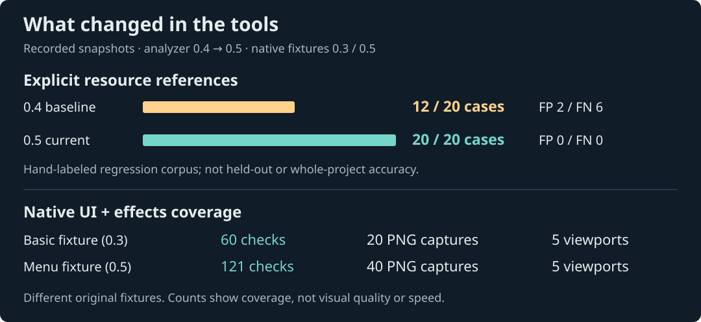
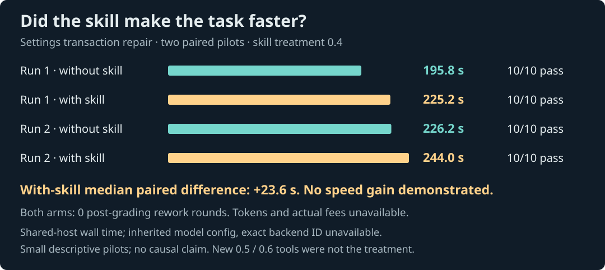

# GameDev Workbench

A practical skill for AI-assisted small and medium game development: project/code architecture, proportionate planning, integrated implementation, team Git workflows and bug fixing. Creative design, native UI and effects remain supported. Offline tools and visual interfaces are optional. [Product direction (Chinese)](docs/PRODUCT-DIRECTION.md).

An installable skill, offline Python toolbox and learning guide for independent developers and small game teams. Priorities: code architecture, native UI, gameplay features and effects, with design, narrative, art and resource-discovery workflows.

[中文与实际截图](README.md) · [Quickstart (Chinese)](docs/QUICKSTART.md) · [0.9 preview](https://github.com/kaltsit2077-dev/gamedev-workbench/releases/tag/v0.9.0-preview) · [Support boundaries](docs/CAPABILITIES.md)



The finite resource-reference regression corpus improved from 12/20 to 20/20 matching cases (false positives 2→0; false negatives 6→0). It was developed alongside the implementation, not held out, and says nothing about whole-project semantic accuracy. [Raw results](docs/analysis-labels-v05.json).

The original Godot menu fixture records 121 checks and 40 native PNG captures over five viewports, including large text, scrolling, nested focus restoration and layered effects. The earlier fixture records 60 checks and 20 frames. These are **different fixtures**, not an aesthetic A/B test or performance benchmark. [Native report](docs/quality-v05/report.json).



Two settings-repair pairs passed the same 10 checks in all four arms, with zero post-grading rework. The with-skill arms (version 0.4) had a median paired wall-time difference of +23.6 seconds. Model configuration was inherited equally; exact backend ID and actual token/billing data were unavailable. Concurrent host load confounds time. **No productivity or cost improvement established; new 0.5/0.6 tools were not the treatment.** [Protocol and evidence](docs/PAIRED-EVALUATION.md).

## Upstream review and dependency checks in 0.9

Selected pinned primary files from ten projects informed focused planning/debugging/save-recovery/cancellation guidance. Maintenance moves and licenses are recorded; no upstream package was installed or code copied. New `check-boundaries` checks explicit observed Godot resource references against project-selected module rules, preserving dynamic/weak/unowned evidence as partial. Five authored tool cases match expectations; this is not whole-project semantic accuracy or a new productivity trial. [Research and adoption decisions](docs/UPSTREAM-REVIEW.md).

## Engineering workflows in 0.8

New project planning, bug fixing and Git collaboration references; optional diagnosis/handoff templates; a local read-only `review-git` command for status, unmerged stages, marker patterns and UID/.meta/case hints. No fetch, merge or repository mutation. Follow the project's own rules and test the final integrated tree. A frozen native Godot integration task compares independent contexts; see [protocol, artifacts and limitations](docs/ENGINEERING-EVALUATION.md). No general productivity or cost benefit is established.

## Optional workspace, introduced in 0.7

The skill is the core; visual organization is supplementary. Existing features include: editable creative packs, an offline task/artifact page with selected-task export, frozen project test previews/explicit execution, and common adapter reports. The page is a read-only snapshot; AI execution still belongs to the host assistant, not a standalone backend.

A small pinned official-demo subset has 8 matching source files / 7 labeled resource edges / zero FP/FN; labels were frozen before the first run but are assistant-authored, not human blind review. Real Godot project tests (7), menu headless checks (81), and Node state checks (2) passed. Unity/Unreal/Blender remain blocked without supplied editors. Three seeded defects escaped parsing but were caught by task tools; this is **not** a new same-model productivity trial. Fees remain unknown. [Long-term architecture](docs/PLATFORM.md) · [Value evidence](docs/VALUE-EXPERIMENTS.md).

```text
python tools/gdw.py create-workspace skills/gamedev-workbench/assets/design/brief.json --output workspaces/my-game
python tools/gdw.py check-workspace workspaces/my-game
python tools/gdw.py workspace-page workspaces/my-game --output workspaces/my-game.html
```

## Use

Python 3.11+, standard library only. From a clone:

```text
python tools/gdw.py validate
python tools/gdw.py gallery docs/quality-v05 --output menu-gallery.html
python tools/gdw.py analyze-project "your Godot project" --output architecture.json
python tools/gdw.py report-analysis architecture.json --output architecture.md
```

Open the HTML locally: viewport filtering, independent A/B frame selection, failed-check filtering and JSON download. It embeds original PNG bytes, makes no network requests and does not run an engine. A standalone sample gallery is also a release asset. Outputs refuse overwrite.

Install the self-contained skill:

```text
python tools/gdw.py install-plan --dest "your client skills directory"
python tools/gdw.py install --dest "your client skills directory"
```

Then ask `$gamedev-workbench` to review architecture, build native menus or implement an effect. Thirteen task modes load references on demand. No upstream software or MCP is installed automatically. Existing installations are not overwritten.

Other tools: narrative boolean-state checks, deterministic integer-economy simulation, manifest-based asset dependency preflight, analysis snapshot comparison, resource search, task briefs and paired-evaluation summaries. [Recipes](skills/gamedev-workbench/references/tool-recipes.md).

Godot fixtures have real Windows / official 4.7.2 / OpenGL evidence. Unity/Unreal original cases and runners exist, but editors are absent and real execution is blocked. Complete physical keyboard/mouse acceptance, hardware gamepad, player testing, performance and third-party MCP validation remain unverified. OS automation is recorded separately. Python CI covers three OSes and two versions; it does not run game engines.

Next: integrate an explicit real-project test adapter; add independent held-out analysis cases; evaluate new tools with traceable costs; finish hardware input and cross-engine runs when environments exist.

[Apache-2.0](LICENSE) for original work. The small pinned Godot official-demo evaluation subset retains its MIT license; see THIRD_PARTY_NOTICES. Other external books, courses, skills and assets remain links/metadata governed by their own licenses. No private game sources or private analysis reports are distributed.
