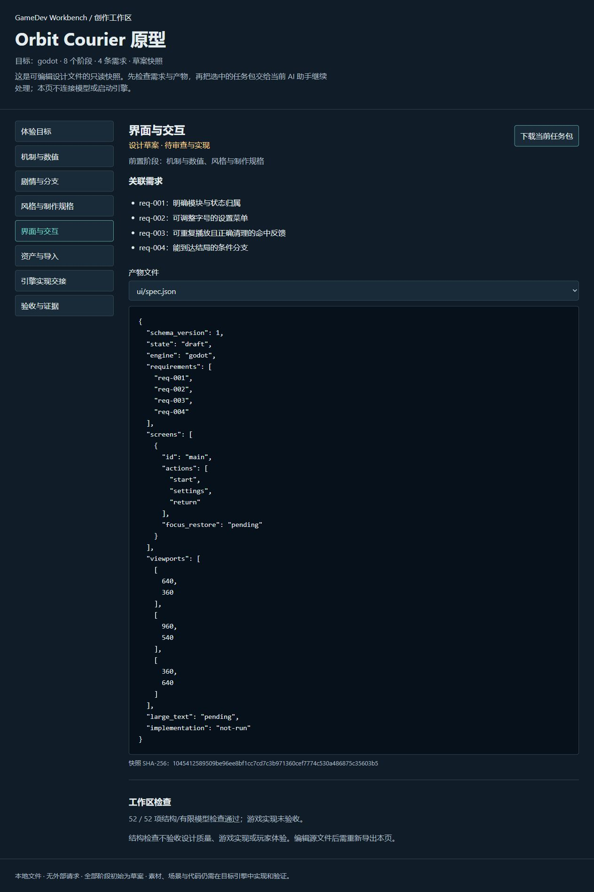
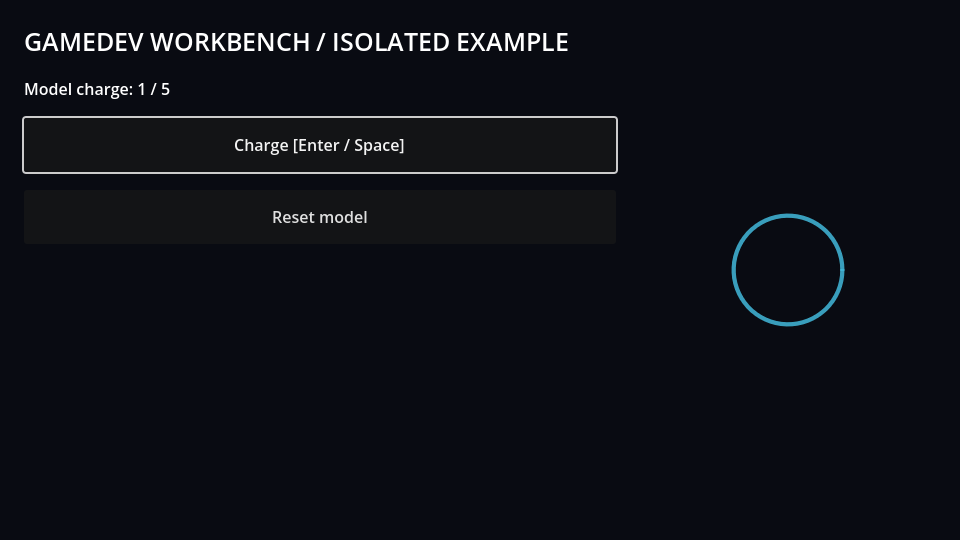
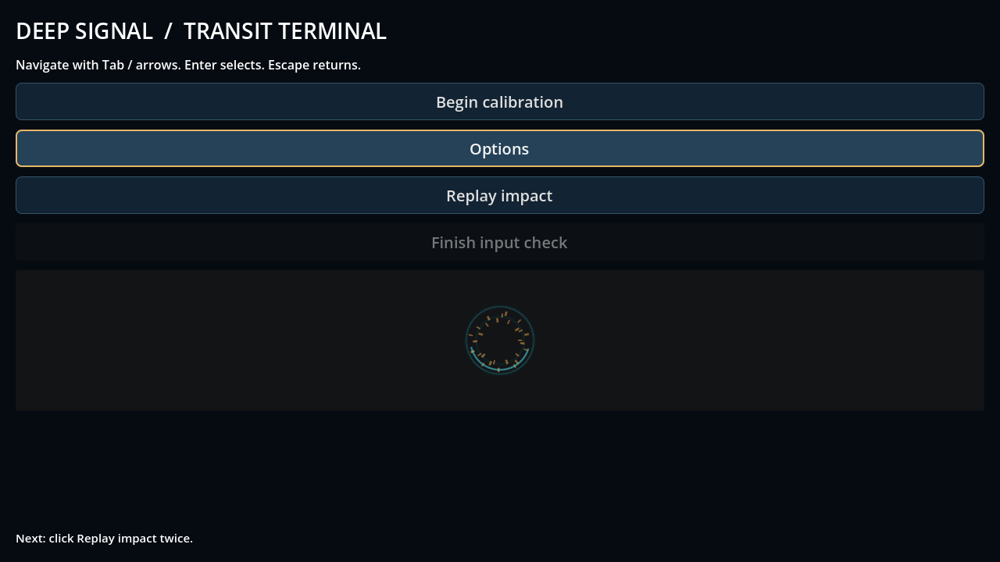
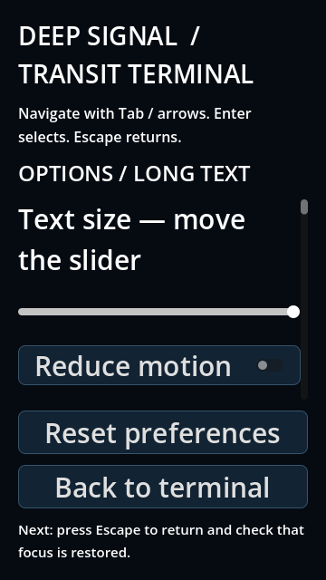
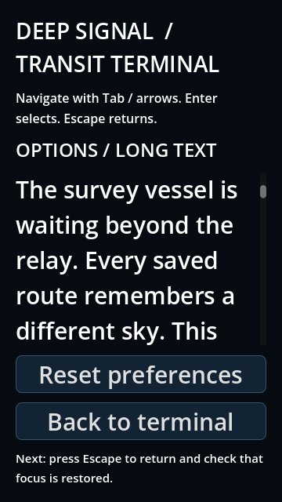
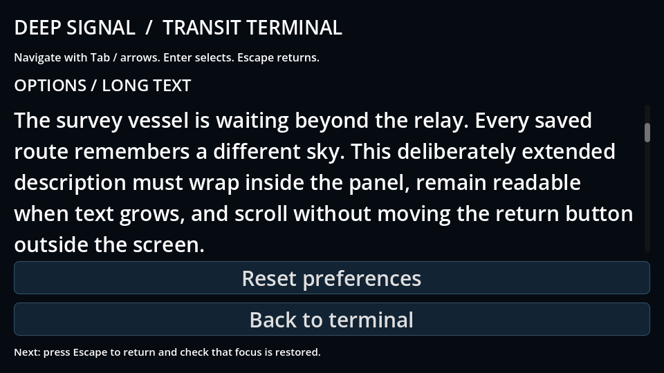
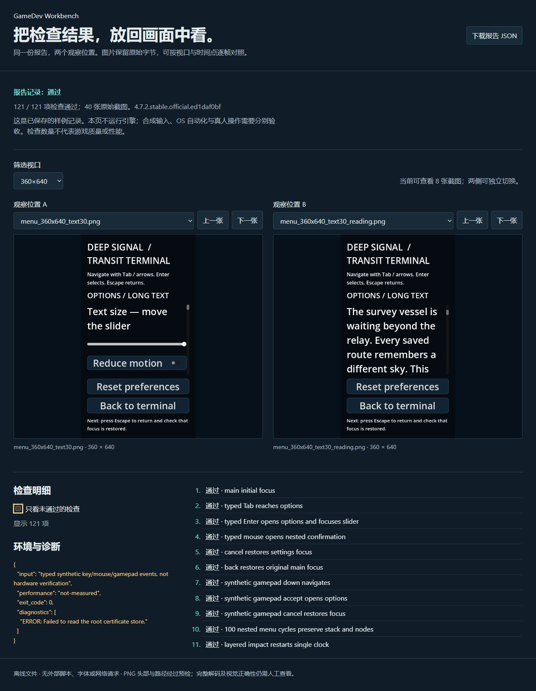
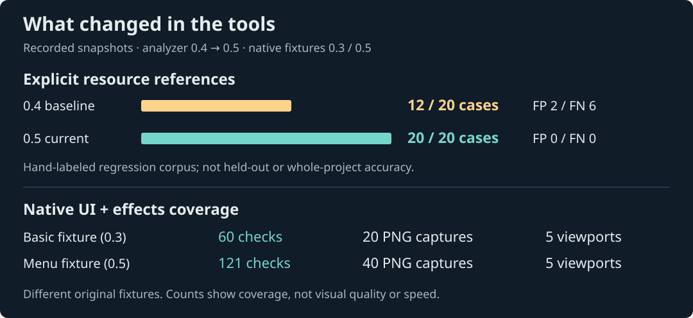
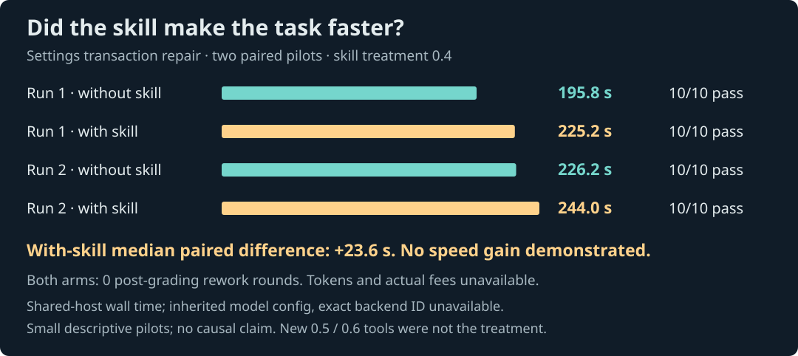

# GameDev Workbench

辅助 AI 开发小型和中型游戏的可安装技能。重点是**项目与代码架构、持续规划、完整功能实现、多人 Git 协作和 Bug 修复**，同时保留创意、风格、原生 UI 和效果工作流。离线工具和可视化按需使用。[具体定位](docs/PRODUCT-DIRECTION.md)。

**可安装技能 + Python 离线工具 + 原创引擎案例 + 有来源的知识库。** Python 工具只用标准库，无 API key；运行引擎案例才需要相应编辑器。

[快速上手](docs/QUICKSTART.md) · [下载 0.9 预览版](https://github.com/kaltsit2077-dev/gamedev-workbench/releases/tag/v0.9.0-preview) · [能力与边界](docs/CAPABILITIES.md) · [路线](docs/ROADMAP.md) · [English](README.en.md)

[](https://github.com/kaltsit2077-dev/gamedev-workbench/actions/workflows/ci.yml)

## 0.9：参考上游，并落实为可检查的改进

查阅 Spec Kit、Superpowers、GSD Core、Godogen、Unciv 等项目的固定版本，补充独立验收、故障取证、存档恢复和旧异步结果取消。记录维护迁移、许可与取舍，未安装上游工具。[10 个项目的研究与落地](docs/UPSTREAM-REVIEW.md)。

新增 `check-boundaries`：按项目自己声明的模块方向复查 Godot 分析快照，列出反向引用；动态加载、普通字符串、未知 UID 或未覆盖文件保留 partial。五个有限工具回归符合预期，**不代表完整架构正确或已证明 AI 提效**。[原始记录](docs/boundaries-v09.json)。

```text
python tools/gdw.py analyze-project "你的Godot项目" --output current-analysis.json
python tools/gdw.py check-boundaries current-analysis.json --rules "项目模块规则.json" --output boundaries.json
```

规则写法见 [工具配方](skills/gamedev-workbench/references/tool-recipes.md)，随包的 `assets/dependency-rules.json` 对应原创 demo，不能直接当作用户工程规则。

## 工程开发流程

- 项目规划、Bug 修复、Git 协作三项独立流程，按改动影响决定记录深度；沿用已有项目规范。
- `review-git` 只读检查本地分支/变更/未解决索引、完整冲突标记、大小写及 UID/.meta 线索；不 fetch、合并或修改仓库。
- 技能要求核对真实入口、状态所有者、失败与清理路径，并在最终集成树上跑受影响回归；补修复与交接模板。
- 新增冻结的原生 Godot“合并冲突＋设置保存＋订阅生命周期”任务，进行独立上下文对照。结果与限制见 [工程任务验证](docs/ENGINEERING-EVALUATION.md)。

```text
$gamedev-workbench 继续这个项目。先读现有约定与决策，审查本次功能涉及的模块和状态归属，按可运行步骤实现并验证。
$gamedev-workbench 定位这个 Bug，先复现和验证根因，再最小修复；保留相关旧行为，并报告实际跑过的回归。
$gamedev-workbench 检查当前分支的集成风险，保留双方功能解决冲突，在最终代码上回归；遵守项目的提交和推送约定。
```

## 现在能做什么

| 你要处理的工作 | 已有能力 | 直接产物 / 入口 |
|---|---|---|
| 项目规划与交接 | 按变化影响拆分可运行步骤，沿用决策/任务/责任记录，恢复时核对真实工作树 | planning 模式、handoff 模板 |
| 多人 Git 协作 | 本地分支/改动/冲突/UID/.meta 线索；语义合并与集成后回归方法 | collaboration 模式、`review-git` |
| Bug 修复 | 复现与根因证据、失败回归、最小修复和相关消费者检查 | bugfix 模式、bugfix 模板 |
| 整体代码架构 | 读项目约束、梳理状态归属、接口与迁移；Godot 只读扫描入口/autoload/引用/UID/循环/赋值线索 | 架构评审技能；`analyze-project`、`report-analysis`、`compare-analysis`、`check-boundaries` |
| 菜单、HUD、效果 | 原生布局、主题、状态栈、键鼠/手柄焦点与事件驱动绑定；Shader/VFX 单时钟、复用与清理方法 | UI/效果技能；原创 Godot 案例、`check-ui-effects`、`gallery` |
| 功能实现与回归 | 从项目契约到代码、资源、场景接入，区分解析/行为/画面/输入等证据 | feature / validation 模式、模板、验证助手 |
| 剧情与分支 | 布尔状态图的断链、软锁和无法到达结局的状态检查 | `check-narrative`；不评判故事质量 |
| 数值经济 | 确定性整数收入、升级策略、敏感性与收支守恒 | `simulate-economy`；不预测玩家或收入 |
| 美术与导入 | 风格参考、资产规格、建模/材质/声音导引；清单路径、hash、PNG 尺寸、glTF/GLB 外部依赖预检 | art 模式、`audit-assets`；不替代编辑器导入 |
| 创意、类型、受众、机制、关卡 | 体验目标、比较方向、最小原型和验证问题 | design 模式与设计模板；由代理结合项目执行 |
| 技能、MCP、开发资料 | 带来源与许可说明的本地目录、工作流与学习导引 | `search`、`inspect`、`brief`；外部工具保留未运行状态 |
| 比较工具是否值得用 | 一致输入、冻结验收、真实产物评分、重复记录与费用来源区分 | `tools/repeated_eval.py`、`summarize-evals` |

技能共十三种按需模式，另含 Godot / Unity / Unreal / Web / Blender 适配指引。[技能入口](skills/gamedev-workbench/SKILL.md) · [学习导引](skills/gamedev-workbench/references/learning-path.md) · [完整能力矩阵](docs/CAPABILITIES.md)。方法指导由代理执行；本地 CLI 不会自动完成整套游戏。

<details>
<summary>可选工作页与已有原生 UI / 效果截图</summary>

### 已有的可选工作页

已有可编辑创作包、离线任务页、项目测试和适配报告。工作页用于整理草案与查看产物，是对话开发的可选补充；无需它也能使用技能。[0.7 技术探索记录](docs/PLATFORM.md)。



```text
python tools/gdw.py create-workspace skills/gamedev-workbench/assets/design/brief.json --output workspaces/my-game
python tools/gdw.py check-workspace workspaces/my-game
python tools/gdw.py workspace-page workspaces/my-game --output workspaces/my-game.html
```

打开新工作页，可在体验、机制、剧情、风格、UI、资产、实现、验收阶段间切换，查看文件并下载当前任务包，交给宿主 AI 结合真实项目继续做。源文件可以编辑；页面是快照，所有阶段初始为草案，结构通过不表示游戏已经完成。发行页另提供可直接双击的 workspace HTML。

本轮新增验证：

- **外部作者源码核验**：固定 Godot 官方 demo 的 8 个文件，首轮前冻结标签；7 条标注资源边全部匹配，误报/漏报均 0。标签仍由本助手整理，不是人类盲评，也不能推广为全工程准确率。[来源、边界和人工核验表](docs/ANALYSIS-REVIEW.md)。
- **实际执行**：Godot 项目声明测试 7 项通过，统一适配菜单 headless 81 项通过；Node 26.5.0 状态/生命周期案例 2 项通过。Unity/Unreal/Blender 缺少可用编辑器路径，记录 blocked；Web 浏览器渲染未测。[共同执行记录](docs/execution-v07.json)。
- **工具的增量作用**：三个正常副本通过；三个预设资源/焦点/效果缺陷仅解析均未检出，专项工具均检出。它是同工件缺陷检测实验，不是模型生产力实验；新增独立同模型、人类盲评与实际费用仍待采集。[原始记录与方法](docs/VALUE-EXPERIMENTS.md)。

项目执行的 `freeze-project-tests` / `project-tests` 默认预览，显式 `--execute` 后才运行选中命令；共同报告拒绝把退出 0、空检查或缺失证据直接当作通过。[配置与使用](skills/gamedev-workbench/references/tool-recipes.md)。

## 先看实际产物

下面是原创 Godot 案例的**原始 OpenGL 截图**。从基础控件/单效果夹具，扩展到可操作的嵌套菜单、长文本、字号调节、焦点恢复与分层命中反馈。

<table>
<tr><th>早期基础夹具 · 0.3</th><th>菜单与分层效果夹具 · 0.5</th></tr>
<tr><td></td><td></td></tr>
</table>

这是**两个不同的自有验证案例**，用来展示功能覆盖的扩展，不是同一游戏 UI 的审美评分，也不是技能带来视觉提升的对照实验。[旧报告](docs/quality-v03/report.json) / [新报告与原始图片](docs/quality-v05/report.json)。

<details>
<summary>查看窄屏、大字号与长文本的真实截图</summary>

<table>
<tr><th>360 × 640 / 30 字号 / 顶部操作</th><th>同视口 / 滚动阅读</th><th>960 × 540 / 30 字号 / 滚动阅读</th></tr>
<tr><td></td><td></td><td></td></tr>
</table>

截图是离散采样，不能证明所有动态过程、翻译长度或硬件输入都正确。

</details>

**0.6 新增：离线画面证据浏览器。** 下载发行页的 `gamedev-workbench-gallery-0.9.0-preview.html`，双击即可按视口筛选、两侧独立逐帧对照、查看失败项与下载原报告。它包含上述 0.5 案例的 40 张原始 PNG；不运行引擎、不联网，也不把旧记录算作新的测试。

<details>
<summary>查看新浏览器的实际页面</summary>



</details>


</details>

## 已实测的改变，以及尚未证明的提升

**0.8 新工程任务：** 独立两组共同原生验收均 13/13、验收后返工 0；只合并功能的阴性对照 4/13。带技能组观察墙钟 336.6 秒，对照 298.1 秒，费用未知；本轮仍未证明技能提效。[任务、产物和局限](docs/ENGINEERING-EVALUATION.md)。



- **资源识别修正：12/20 → 20/20。** 同一有限标注集上，显式资源引用误报 2 → 0、漏报 6 → 0；补到的情况包括常量拼接、UID 和简单替换，过滤了不支持的方法调用。这是随实现建立的回归集，**不是独立留出集，也不是全工程准确率**。[逐例结果](docs/analysis-labels-v05.json) · [夹具](evals/analysis/labeled-cases.json)。
- **UI/效果检查扩展：基础案例 60 项/20 帧，新菜单案例 121 项/40 帧。** 新增嵌套返回焦点、长文本滚动、20/30 字号、100 次菜单往返、1000 次效果复用和暂停/隐藏/清理检查。计数表示这些夹具的覆盖；不代表帧率、质量分数或任意用户工程已经通过。[验证范围](docs/VALIDATION.md)。



**生产力结论保留为“尚未证明”。** 两轮设置事务任务四组均 10/10，共同验收后返工均 0；带 0.4 技能组的配对耗时差中位数是 **+23.6 秒**。两组沿用相同父级模型配置，但精确后端 ID 不可得；并发、宿主负载和文档时间影响墙钟。实际 token/费用缺失，不能据此宣传省钱。新增 0.5/0.6 工具未作为这些实验的处理项。[原始记录](docs/transactions-results.json) · [完整方法和首轮实验](docs/PAIRED-EVALUATION.md)。

两张图由 `python tools/readme_visuals.py` 读取归档 JSON 生成，CI 用 `--check` 防止图表与记录漂移。

## 三种开始方式

### 已安装技能：直接说任务

本机已有 `gamedev-workbench` 时，在支持该技能的客户端中发起：

```text
$gamedev-workbench 审查当前项目整体代码架构。先读项目约束，再只读收集入口、依赖与状态写入线索，给出可执行的改进顺序。
$gamedev-workbench 制作原生设置菜单，验证窄屏、长文本、返回焦点和重复打开后的清理。
$gamedev-workbench 实现可重复播放的命中特效，并提供触发、暂停、结束与清理证据。
```

### 想先看工具：无需引擎

需要 Python 3.11+，在克隆目录执行：

```text
git clone https://github.com/kaltsit2077-dev/gamedev-workbench.git
cd gamedev-workbench
python tools/gdw.py validate
python tools/gdw.py gallery docs/quality-v05 --output menu-gallery.html
```

双击新生成的 `menu-gallery.html` 查看已有真实截图。另可直接体验叙事和经济样例：

```text
python tools/gdw.py check-narrative skills/gamedev-workbench/assets/design/narrative.json
python tools/gdw.py simulate-economy skills/gamedev-workbench/assets/design/economy.json
```

### 用在自己的 Godot 工程：先只读

```text
python tools/gdw.py analyze-project "你的Godot工程目录" --output architecture.json
python tools/gdw.py report-analysis architecture.json --output architecture.md
```

工具不启动游戏，不改源码；报告是**有范围和未知项的文本线索**，需人工核对架构结论。改动后另存快照，可用 `compare-analysis` 找出结构变化。输出采用独占创建，再运行请换新文件名。[从安装到真实工程的完整步骤](docs/QUICKSTART.md)。

## 安装与运行引擎案例

```text
python tools/gdw.py install-plan --dest "你的客户端技能目录"
python tools/gdw.py install --dest "你的客户端技能目录"
```

安装只复制自包含技能，不安装上游软件、不注册 MCP、不覆盖同名技能。已有旧版时先备份或选择新目录；客户端重新发现后可用。技能 ZIP 可独立分发，完整项目 ZIP 包含案例、证据、评估与开发工具。[工具配方](skills/gamedev-workbench/references/tool-recipes.md)。

原创 Godot 菜单/效果案例需要官方 **4.7.2**，在临时副本执行：

```text
python tools/gdw.py check-ui-effects --case menu --engine "Godot官方可执行文件路径" --scratch "引擎可写缓存目录" --output-dir "新的菜单证据目录" --graphical
python tools/gdw.py gallery "新的菜单证据目录" --output "新的菜单浏览.html"
```

省略 `--graphical` 不产画面。此命令运行**包内案例**，不会接管你的游戏。

| 验证对象 | 当前状态 |
|---|---|
| Python 工具 | Windows 本地测试；CI 覆盖 Windows / Linux / macOS × 3.11 / 3.14 |
| Godot 自有案例 | Windows / 官方 4.7.2 / OpenGL 实跑；有检查与原始画面 |
| 实体键鼠 / 手柄、真人试玩、性能 | 完整实体键鼠流程尚未通过，实体手柄未验证；OS 自动化独立记录，性能未测 |
| Unity / Unreal | 原创源码案例与运行入口已准备；本机无编辑器，真实执行 blocked |
| 第三方技能 / 编辑器 MCP | 目录与研究指引可用，未安装验证；不把来源声明当实测 |

## 下一步优先做什么

以 [产品定位](docs/PRODUCT-DIRECTION.md) 和 [路线](docs/ROADMAP.md) 为准，优先收集真实架构、功能、多人集成和故障修复任务的结果，检验遗漏、返工和维护成本。界面与 MCP 按实际缺口增加。

1. **接入一个真实项目的 UI/效果验证夹具。** 显式选择场景、控件和触发点，复用报告/浏览器；让现有检查真正进入日常回归。先保留项目自己的装配和测试约定。
2. **独立留出案例检验架构扫描。** 加入未参与开发的 UID/动态引用样本，复核误报/漏报；运行时资源保留未知，避免假装完整理解源码。
3. **评估新工具而非只评估提示词。** 用真实架构/UI任务比较有无分析器、浏览器的结果、返工、总耗时和可追溯账单，再判断是否值得默认启用。
4. **补实体键鼠与真实引擎记录。** 完成现有人工步骤；Unity/Unreal 安装后先跑独立案例，有明确编辑器操作缺口才接 MCP。

项目可以作为开源预览版使用和反馈，尚不以“全面自动开发”或“已证明提效”作发布承诺。[详细路线和触发条件](docs/ROADMAP.md)。

## 参与与许可

[贡献指南](CONTRIBUTING.md) · [验证报告](docs/VALIDATION.md) · [变更记录](CHANGELOG.md) · [第三方声明](THIRD_PARTY_NOTICES.md)

原创代码与文档采用 [Apache-2.0](LICENSE)。来源目录主要保存链接和元数据；外部评估中的少量 Godot 官方源码保留其 MIT 许可。第三方书籍、课程、技能或资产不随包重打包；使用外部资源时遵守其许可。公开包不包含私有游戏源码或私有工程分析报告。
