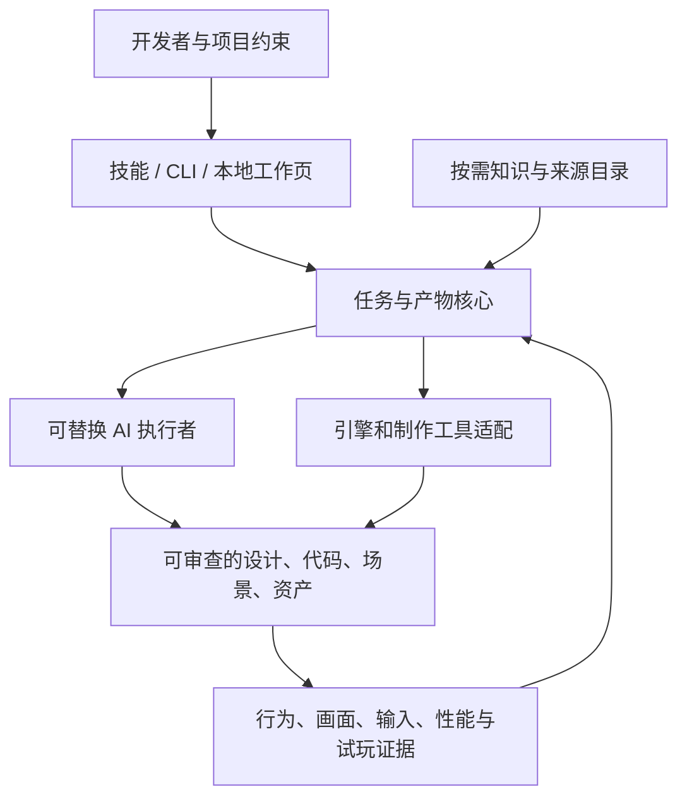

# 长期产品：本地优先的 AI 游戏开发工作台

产品方向：**平台是最终形态；技能是 AI 的工作入口；知识库、工具和适配器是共享核心。** 各部分保持可独立使用，让个人开发者能从一个明确任务开始，也让小团队逐步接入自己的工程、模型与制作工具。

当前 0.7 是平台基础：可编辑创作包、任务工作页、项目测试契约、统一适配报告和可复现评估。工作页是离线只读快照；AI 仍由当前宿主助手执行，没有独立聊天后台、持续任务服务或自动完成游戏的能力。

## 长期架构

- **任务与产物核心**：需求 ID、依赖、版本、源指纹、可编辑文件、执行与审查状态。设计草案、文件存在、结构通过、引擎通过、人工接受分别登记。
- **知识层**：工作流、来源、许可、版本、案例和失效经验。按当前任务取最少必要内容；项目约束优先。向量检索是否引入取决于真实资料规模与检索效果。
- **AI 执行层**：先接当前宿主代理。后续供应商适配必须支持可审查变更、上下文范围、取消/恢复、预算与实际用量；接入账号和费用由使用者明确配置。
- **工具层**：只读分析、专项模拟、资产预检、显式项目测试、引擎案例。稳定输出格式优先于把工具都改成同一种框架。
- **适配层**：共用任务与证据格式，保留各引擎原生实现。Godot、Unity、Unreal、Web、Blender 的“有入口/已运行/已集成”分开标记。编辑器 MCP 按现场状态、选取/修改/撤回或交互调参的实际缺口接入。
- **工作台界面**：任务、设计产物、修改差异和证据统一导航。0.7 提供可查看草案和导出任务的离线工作页；后续再接项目服务与可审查的 AI 执行。

## 从一个任务走到交付

以“给现有游戏制作设置菜单和命中反馈”为例：

1. 明确体验目标、受众、已有项目规则、引擎与输入设备。
2. 生成并编辑关联的机制、剧情、风格、UI 和资产规格；确认必要参考与许可。
3. AI 读取当前任务和真实项目，提出改动范围与状态契约，完成可编辑代码/场景/资源。
4. 预览并运行项目明确声明的测试；使用独立临时样例时记录其范围，不能替真实游戏验收。
5. 在任务页比较实际修改和证据，补真人操作与试玩，再继续迭代。

其中第 3 步的独立平台执行服务与第 5 步的实时项目面板仍是后续目标。现有技能可以帮助宿主助手完成相应工作，但离线页面本身不执行它们。

## 演进阶段与进入条件

| 阶段 | 面向使用者的结果 | 进入下一阶段的条件 |
|---|---|---|
| 共享核心（当前推进） | 设计包、分析、显式测试、原生案例、证据查看可以组合使用 | 真实项目连续使用，外部案例与失败路径可靠 |
| 本地项目工作台 | 一处查看任务、文件差异、设计版本、引擎运行和反馈；可暂停恢复 | 多位独立用户完成任务，兼容升级和恢复可测 |
| 跨引擎制作链 | 每个后端有原生 UI/效果/资产导入案例，按任务切换 | 对应编辑器的真实读/改/撤回/运行/停止与画面记录 |
| 可替换 AI 执行层 | 同一项目选择宿主/供应商，看到实际预算、用量和执行边界 | 独立任务质量、总耗时、返工和实际费用对照 |
| 小团队与扩展生态 | 可选共享任务、评审、经过版本核验的扩展目录 | 稳定契约、维护者与权限责任；离线核心仍能独立工作 |

这些是能力门槛，不是按日历承诺。跨引擎、美术建模、音频、关卡、本地化和发行逐步形成各自的原生案例与验证，不以目录条目多来代替实际可用。

## 本轮结果与剩余工作

0.7 已有 8 阶段创作工作区和检查、离线任务页/任务包导出、显式项目测试预览/快照/执行、五类适配入口。实际记录见 [执行证据](execution-v07.json)、[外部分析核验](ANALYSIS-REVIEW.md) 与 [价值实验](VALUE-EXPERIMENTS.md)。

真实游戏 UI/VFX 接入、独立人类评审、新版同模型配对、可追溯账单、Unity/Unreal/Blender 真实执行仍待完成。它们是下一阶段的明确验收项，不能用本轮脚本和样例通过替代。
